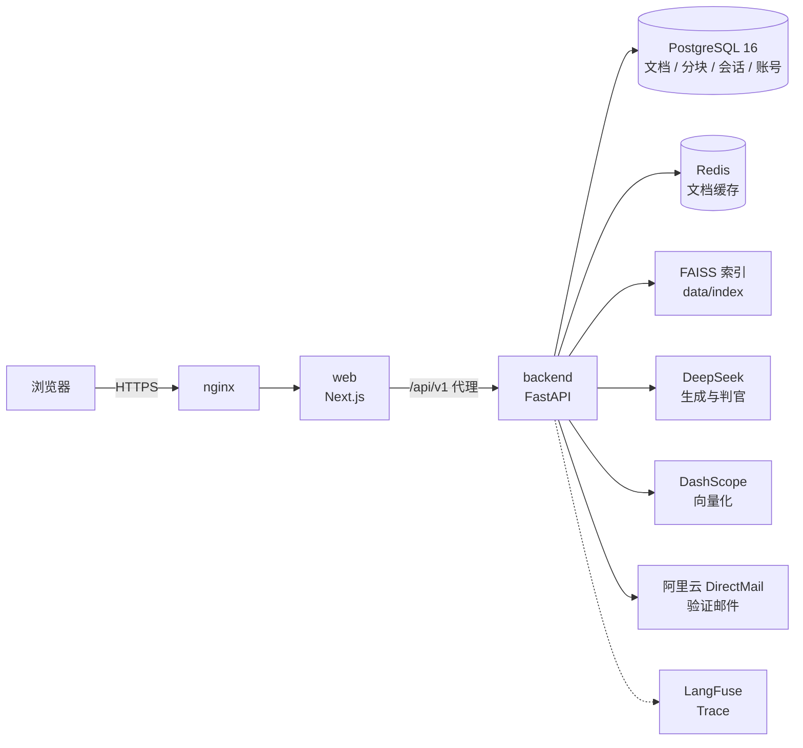

# RAG 知识库问答

上传 PDF / Markdown / TXT 文档，就能基于文档提问。回答带引用编号 `[n]`，点击引用可以看到原文块及其前后相邻块，目标块高亮。同一套知识库也可以通过 MCP Server 提供给 Claude Desktop 等客户端调用。

在线体验：<https://suming.work>（开放注册，需完成邮箱验证后登录）

## 功能

- **文档入库**：上传后自动解析、切分、向量化并写入索引。仓库自带 `data/corpus/` 中的 6 篇技术文档。
- **带引用的问答**：回答中的 `[n]` 对应引用来源。引用可以定位到原文块，并显示前后相邻块。
- **多轮会话**：会话保存在服务端。追问时带入最近 5 轮（`CHAT_HISTORY_TURNS`），被拒答的轮次不计入上下文。
- **用户隔离**：每个用户的文档、会话、检索结果互不可见。语料库文档对所有用户共享。
- **注册与登录**：开放注册，邮箱验证链接由阿里云 DirectMail 发送。登录态是 HMAC 签名的 httpOnly cookie。
- **找回密码**：输入注册邮箱，收到 6 位验证码（10 分钟有效，错误 5 次作废），验证后设置新密码。
- **注销账号**：登录后用发往本人邮箱的验证码确认，删除账号及其全部文档与会话。持有共享语料的账号不能注销。
- **Agentic RAG**：基于 LangGraph 的查询分类、相关性评分、查询重写（最多 2 次）和工具调用。目前用于离线评测，线上问答走固定管线。
- **MCP Server**：把知识库暴露为 2 个 Tool、2 个 Resource、2 个 Prompt，见 [MCP Server](#mcp-server)。

## 架构

线上请求路径：



问答管线（线上）：问题经 FAISS 取回 `RAG_RETRIEVE_K=20` 条，取前 `RAG_FINAL_K=5` 条作为上下文，连同会话历史交给 DeepSeek 生成，再把 `[n]` 映射回引用，最后写入会话。

Agentic 链路（离线评测与 Agent 实验）：

```
prepare → classify ─┬─ chitchat ──────────────────────────────→ END
                    └─ retrieve → assemble → grade ─┬─ generate → citations → END
                                  ↑                  └─ rewrite ─┘（最多 2 次）
```

## 技术栈

| 层 | 选型 |
|---|---|
| 后端 | Python 3.11、FastAPI、asyncpg、Redis、Pydantic Settings |
| 检索 | FAISS（`IndexIDMap` + `IndexFlatIP`）、DashScope `qwen3.7-text-embedding-flash`（1024 维） |
| 生成 | DeepSeek（OpenAI 兼容接口）、LangGraph 1.x（Agent 链路） |
| 可观测 | LangFuse |
| 前端 | Next.js 16、React、TypeScript |
| 认证 | bcrypt、HMAC-SHA256 签名 cookie（标准库实现） |
| 邮件 | 阿里云 DirectMail，按 RPC 签名规则直接调用，不引入 SDK |
| MCP | 官方 `mcp` Python SDK 2.x |
| 部署 | Docker Compose、GitHub Actions（手动触发）、自托管 Runner、阿里云 ECS 与 ACR、nginx、acme.sh（DNS-01） |

## 指标

以下数据来自自建评测集：60 题，其中 50 题可答、10 题为负样本（语料中没有答案，期望拒答）。判官为 DeepSeek。所有对比都是同一批次、同一判官缓存下得到的。

### 切分策略对比（`final_k=5`）

| 指标 | splitter（线上） | sentence | fixed_size | paragraph |
|---|:---:|:---:|:---:|:---:|
| Faithfulness | 0.997 | **1.000** | 0.997 | 0.994 |
| Answer Relevance | 0.982 | 0.987 | 0.982 | **0.994** |
| Context Precision（判官） | 0.949 | **0.967** | **0.969** | 0.927 |
| Hit Rate@5 | 1.000 | 1.000 | 1.000 | 1.000 |
| MRR | 0.952 | 0.943 | 0.964 | **0.980** |
| 幻觉率 | 2.04% | **0.00%** | 2.04% | 4.17% |
| 误拒率 | **2.00%** | 8.00% | **2.00%** | 4.00% |

四种策略的判官指标差异在 5% 以内。在这份结构清晰的技术文档上，切分策略不是生成质量的主要影响因素。线上选择 `splitter`，它有 200 字 overlap，误拒率与 `fixed_size` 并列最低。

### 基础 RAG 与 Agentic RAG 对比

| 指标 | 基础 RAG | Agentic RAG |
|---|:---:|:---:|
| Faithfulness | 0.989 | **0.998** |
| 幻觉率 | 8.33% | **2.17%** |
| Hit Rate | 0.980 | **1.000** |
| MRR | 0.945 | **0.952** |
| 误拒率 | **4.00%** | 8.00% |
| 平均延迟 | **972 ms** | 2827 ms |

Agentic 在忠实度和幻觉率上更好，代价是延迟约 2.9 倍，误拒率翻倍。延迟敏感的场景应选基础 RAG。

评测的局限：题目是自己写的，规模只有 60 题，判官与被测模型同属一个家族，判官分数还会随批次漂移。这些数字只能用来比较同一批次内的配置，不能代表通用效果。

完整数据见 [docs/week10/strategy_comparison.md](docs/week10/strategy_comparison.md) 和 [docs/week13/ab_report.md](docs/week13/ab_report.md)。

## 失败案例

1. **Agent 误拒翻倍（4% → 8%）**。多出来的误拒是 q044 和 q046。相关性评分在拿不准时倾向低分，从而触发重写。两次重写仍不达标，就带着不理想的上下文生成，最后被拒答。每多一层判断，误判概率就会累积。
2. **检索 top1 未命中答案，触发拒答**。q020 的 top1 是相邻章节的「重复 ingest 冲突」块，而答案所在的块排在后面。生成层的拒答指令又过于绝对，两者叠加导致误拒。改进方向包括提高 `final_k`、加入 rerank、放松拒答指令、为 sentence 策略加 overlap。后两项尚未实施。
3. **ReAct 模式引用为 0**。模型输出自由格式的 Markdown，不带 `[n]`。解法是混合架构：Agent 负责收集信息，最终答案交给带引用约束的标准管线重新生成。修复后引用从 0 条变为 3 条，并正确映射。
4. **计算器的资源耗尽漏洞**。AST 白名单挡住了代码执行，但没有挡住资源消耗：`9**9**9` 会让进程卡死且无法中断。修复方式是在求值前检查指数（上限 10000）和结果位数（上限 10 万位）。

## 快速开始（本地）

环境要求：Python 3.11+、Docker、Node.js 20.9+（Next.js 16 的要求）。

```bash
# 1. 启动 PostgreSQL 与 Redis。首次启动会自动执行 app/db/migrations
docker compose up -d

# 2. Python 依赖
python -m venv RAG_venv
source RAG_venv/bin/activate        # Windows: RAG_venv\Scripts\activate
pip install -r requirements.txt

# 3. 复制环境变量模板并填写。至少需要 DEEPSEEK_API_KEY、DASHSCOPE_API_KEY、AUTH_SECRET_KEY
cp .env.example .env
#    本机 http 调试需要把 AUTH_COOKIE_SECURE 改为 False
#    MAIL_BACKEND 保持 log：验证链接会打印到后端日志，仅限本机使用

# 4. 构建向量索引
python scripts/build_index.py --verify

# 5. 启动后端
uvicorn app.main:app --reload --port 8000

# 6. 启动前端（另开一个终端）
cd web && npm install && npm run dev
```

打开 <http://localhost:3000>。注册后，验证链接在后端日志中。也可以用迁移自带的 `demo_user` 账号，通过 `python scripts/set_password.py` 设置密码后直接登录。

运行测试：

```bash
pytest -q
```

测试使用内存替身，不调用外部 API，CI 中同样运行。

## 部署

- 镜像：`Dockerfile`（后端）与 `web/Dockerfile`（前端，standalone 构建）构建后推送到阿里云 ACR。ECS 上的自托管 Runner 从 VPC 内网地址拉取镜像。
- 流程：GitHub Actions 的 `Build and deploy` 手动触发，依次执行 test → build → deploy。推送到 master 不会自动上线。
- 服务编排：`docker-compose.prod.yml`，包含 postgres、redis、backend、web。端口只绑定 127.0.0.1。
- 反向代理：`deploy/nginx/rag.conf`，HTTPS 证书由 acme.sh 通过阿里云 DNS（DNS-01）签发并自动续期。
- 数据库迁移：`docker-entrypoint-initdb.d` 只在空数据卷上执行。已有数据库需要手动执行 `app/db/migrations/` 下新增的迁移文件。

生产环境变量只在服务器的 `.env` 和 GitHub Secrets 中配置，不入库。主要变量如下：

| 变量 | 作用 |
|---|---|
| `DEEPSEEK_API_KEY`、`DASHSCOPE_API_KEY` | 生成与向量化 |
| `POSTGRES_*`、`REDIS_*` | 数据库与缓存连接 |
| `AUTH_SECRET_KEY` | 登录 cookie 签名密钥，生产必须设置 |
| `AUTH_COOKIE_SECURE` | 默认 `True`，本机 http 调试设为 `False` |
| `MAIL_BACKEND` | `log`（默认，只打印日志）或 `directmail` |
| `ALIYUN_ACCESS_KEY_ID`、`ALIYUN_ACCESS_KEY_SECRET`、`ALIYUN_DM_ACCOUNT_NAME` | DirectMail 凭据及已验证的发信地址 |
| `PUBLIC_BASE_URL` | 邮件中验证链接的前缀 |
| `LANGFUSE_PUBLIC_KEY`、`LANGFUSE_SECRET_KEY` | Trace 上报 |
| `CHUNK_STRATEGY` | 线上生效的切分策略，默认 `splitter` |

完整的上线清单、验证记录和部署踩坑表见 [docs/week15/README.md](docs/week15/README.md)。

## MCP Server

MCP Server 把知识库的检索能力以标准协议提供给外部 AI 客户端。它是一个 stdio 进程，从项目根目录启动：

```bash
python -m app.mcp_server
```

运行前需要先构建索引（`scripts/build_index.py`）。`get_document_by_id` 还需要数据库可用，未连接时只有检索工具可用。

| 类型 | 名称 | 说明 |
|---|---|---|
| Tool | `search_documents` | 语义检索，返回带来源标注的文本片段 |
| Tool | `get_document_by_id` | 按文档 ID 分页读取原文 |
| Resource | `docs://list` | 文档清单，来自索引元数据，不查数据库 |
| Resource | `docs://stats` | 知识库统计与可用工具 |
| Prompt | `rag_qa` | 先检索再作答，并标注来源 |
| Prompt | `summarize_document` | 通读指定文档并生成结构化摘要 |

接入 Claude Desktop 时，在 `claude_desktop_config.json` 的 `mcpServers` 中加入下面的配置，并与已有内容合并。`command` 必须指向装好依赖的虚拟环境中的 Python：

```json
{
  "mcpServers": {
    "rag-knowledge-base": {
      "command": "<项目根目录>/RAG_venv/Scripts/python.exe",
      "args": ["-m", "app.mcp_server"],
      "env": {
        "PYTHONPATH": "<项目根目录>",
        "PYTHONIOENCODING": "utf-8"
      }
    }
  }
}
```

macOS / Linux 的虚拟环境路径为 `RAG_venv/bin/python`。修改配置后需要完全退出并重新启动客户端。

MCP Server 的独立发布仓库：<https://github.com/KaiHangJia789/rag-mcp-server>

## 目录结构

```
app/
  api/v1/       REST 接口：auth、documents、upload、qa、sessions
  agent/        LangGraph Agent 与工具
  rag/          固定 RAG 管线
  parsing/      文档解析与切分策略
  vector/       FAISS 索引
  services/     业务服务
  db/           连接、仓库、迁移
  mcp_server/   MCP Server
  evaluation/   离线评测（指标与判官）
web/            Next.js 前端
scripts/        索引构建、评测、MCP 冒烟测试
deploy/nginx/   反向代理配置
docs/week*/     各周实验记录与评测报告
tests/          pytest 用例
```

## 已知问题

- **追问的检索只用本轮问题**。「它有什么用」这类依赖上文的追问可能检索不到相关内容。查询改写尚未实现。
- **Agentic 链路未接入线上问答**，目前只用于评测。
- **对抗测试集（20 题）尚未自动评分**，目前靠人工判读。
- **`web_search` 默认是本地语料实现**，不能联网。接入真实搜索 API 需要实现 `SearchBackend` 协议。
- **MCP Server 不做用户过滤**。它是本地进程，拥有运行者的数据库访问权限。
- **注册依赖 DirectMail 发信域名验证**。未配置或未验证时，注册会成功但收不到邮件，用户可以在登录页重新发送。
- **改密码或注销后，已签发的登录 cookie 在 7 天有效期内仍可通过签名校验**。cookie 是无状态令牌，服务端没有吊销机制。注销后这些 cookie 对会话、上传等写操作返回 401。
- **单独删除文档时，其向量没有从 FAISS 索引中移除**，直到下一次重建索引才会清理。账号注销已经会移除。
- **部署依赖阿里云 ACR 与 ECS 的网络**。国内 ECS 访问 GitHub 与 GHCR 不稳定，因此镜像改为 ACR 内网拉取，部署改为手动触发。
- **向量索引（`data/index/`）不入库**，新环境需要手动执行 `build_index.py`。

## 许可证

MIT，见 [LICENSE](LICENSE)。

## 相关文档

- [docs/week15/README.md](docs/week15/README.md)：本周任务、上线清单、验证记录、部署踩坑
- [docs/week14/README.md](docs/week14/README.md)：MCP Server 设计与 Claude Desktop 配置说明
- [docs/week13/README.md](docs/week13/README.md)：Agentic RAG 实现、工具安全与对抗测试集
- [docs/week13/ab_report.md](docs/week13/ab_report.md)：基础 RAG 与 Agentic RAG 的 A/B 报告
- [docs/week10/strategy_comparison.md](docs/week10/strategy_comparison.md)：切分策略对比报告
